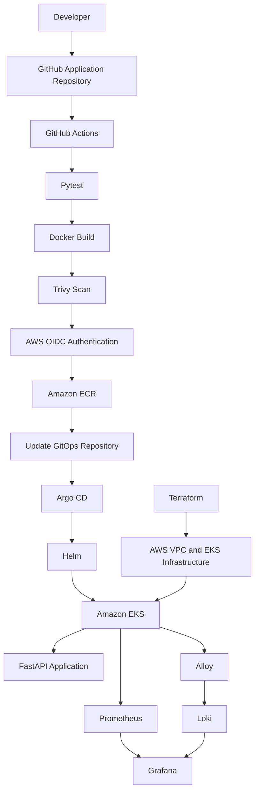

# Platform Infrastructure

Terraform-managed AWS infrastructure for a Kubernetes-based DevOps platform.

## Architecture

This project provisions and manages the AWS infrastructure required to run a containerized application platform with automated CI/CD, GitOps deployment, monitoring and centralized logging.

### Technology Stack

**Cloud and Infrastructure**
- AWS
- Terraform
- Amazon VPC
- Amazon EKS
- Amazon ECR
- AWS IAM
- GitHub Actions OIDC

**CI/CD and GitOps**
- GitHub
- GitHub Actions
- Docker
- Trivy
- Kubernetes
- Helm
- Argo CD

**Monitoring and Logging**
- Prometheus
- Grafana
- Loki
- Grafana Alloy
- Metrics Server
- kube-prometheus-stack

**Automation**
- PowerShell
- AWS CLI
- kubectl

## AWS Infrastructure

Terraform provisions:

- VPC with CIDR `10.0.0.0/16`
- Two public and two private subnets
- Internet Gateway and NAT Gateway
- Route tables and subnet associations
- Amazon EKS cluster
- EKS managed node groups
- Amazon ECR repository
- IAM roles and policies
- GitHub OIDC identity provider and deployment role
- EBS CSI driver and Pod Identity Agent add-ons
- IAM integration for AWS Load Balancer Controller

## Architecture Diagram



## Repository Structure

```text
platform-infrastructure/
├── scripts/
│   └── bootstrap-argocd.ps1
└── terraform/
    ├── ebs-csi.tf
    ├── ecr.tf
    ├── eks.tf
    ├── oidc.tf
    ├── lbc-iam-policy.json
    ├── providers.tf
    ├── variables.tf
    ├── outputs.tf
    └── versions.tf
```

## Prerequisites

Install and configure:

- AWS CLI
- Terraform
- kubectl
- Helm
- PowerShell
- Access to the AWS account used for this project

The examples use AWS region `ap-south-1` and AWS CLI profile `portfolio`.

## Deploy Infrastructure

From the repository root:

```powershell
$env:AWS_PROFILE = "portfolio"
$env:AWS_REGION = "ap-south-1"

terraform -chdir=terraform init
terraform -chdir=terraform validate
terraform -chdir=terraform plan
terraform -chdir=terraform apply
```

Review the Terraform plan before applying changes.

## Configure kubectl

After the EKS cluster is available:

```powershell
aws eks update-kubeconfig `
  --region ap-south-1 `
  --name devops-portfolio-eks

kubectl get nodes
```

## Bootstrap Argo CD and GitOps Applications

Cluster-scoped components must be deployed through repeatable automation rather than relying on manual installation steps.

The bootstrap script:

1. Checks the active Kubernetes context.
2. Validates the expected Argo CD application manifests.
3. Retrieves the VPC ID from Terraform output.
4. Installs Argo CD.
5. Waits for Argo CD deployments.
6. Applies the six Argo CD Application manifests.
7. Configures the AWS Load Balancer Controller application with the Terraform VPC ID.

Run:

```powershell
.\scripts\bootstrap-argocd.ps1 `
  -GitOpsRepoPath "C:\Users\hp\platform-gitops"
```

The script submits the applications. Verify their health and synchronization in Argo CD afterwards.

## Validation Status

- Terraform plan completed with no infrastructure changes.
- Six Argo CD applications were verified as Synced and Healthy.
- End-to-end application deployment through GitHub Actions, ECR, GitOps and Argo CD was validated.
- A complete destroy-and-recreate test has not yet been performed.

## Important Operational Notes

- The EKS API endpoint is public but restricted using a configured CIDR allowlist. Set this to your own public IP CIDR when deploying.
- The cluster uses a NAT Gateway for private-subnet outbound connectivity.
- Loki has persistent EBS-backed storage.
- Prometheus and Grafana currently do not have persistent volumes, so their stored data can be lost when pods are recreated.
- Terraform state and plan files can contain sensitive information. Never commit state files, backups or plan files to Git.
- Actual ongoing monthly AWS cost has not yet been established from a representative period of usage.
- A full infrastructure rebuild remains an outstanding validation task.